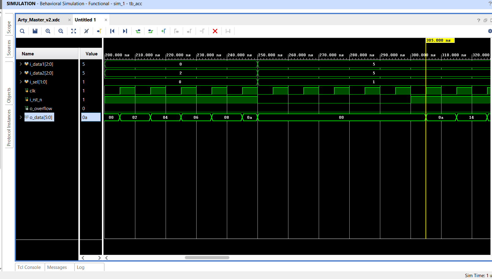

# 02 · Accumulator with overflow flag

A 6-bit accumulator whose input is selected from two 3-bit operands or their sum. It runs on the Arty A7, with operands on switches and buttons and the result on the LEDs.

## Function

| `i_sel` | Value added each clock cycle |
|---------|------------------------------|
| `00` | `i_data2` |
| `01` | `i_data1 + i_data2` |
| `10` | `i_data1` |
| `11` | `0` (hold) |

The register is 7 bits wide: `o_data` is bits [5:0] and `o_overflow` is bit 6, the carry out of the most recent addition. Because only bits [5:0] are fed back, the accumulator wraps modulo 64 and `o_overflow` is high for one cycle per wrap. Reset is asynchronous and active low.

Example: with `i_sel = 01` and `i_data1 = i_data2 = 1`, the accumulator adds 2 per cycle and raises `o_overflow` after 32 clock cycles.

## Interface

| Port | Dir | Board mapping |
|------|-----|---------------|
| `clk` | in | 100 MHz clock |
| `i_rst_n` | in | CK_RST button (active low) |
| `i_sel[1:0]` | in | SW0–SW1 |
| `i_data1[2:0]` | in | SW2–SW3, BTN0 |
| `i_data2[2:0]` | in | BTN1–BTN3 |
| `o_data[5:0]` | out | Red channel of RGB LEDs 0–3, LD4–LD5 |
| `o_overflow` | out | LD6 |

## Verification

`tb/tb_acc.v` applies directed vectors for every `i_sel` value with resets in between (`make acc`). Waveforms from Vivado behavioral simulation:

All captures are in [`docs/waveforms`](docs/waveforms).
