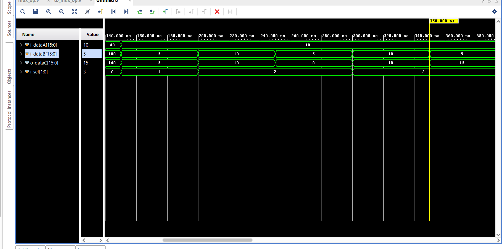

# 03 · 16-bit 4-operation ALU

Combinational ALU (module `mux_op`) that computes four operations in parallel and selects one with a 2-bit opcode.

| `i_sel` | `o_dataC` |
|---------|-----------|
| `00` | `i_dataA + i_dataB` |
| `01` | `i_dataA - i_dataB` |
| `10` | `i_dataA & i_dataB` |
| `11` | `i_dataA \| i_dataB` |

Results wrap modulo 2^16; there are no carry or overflow outputs.

## Verification

`tb/tb_mux_op.v` applies directed vectors for each operation (`make alu`).

