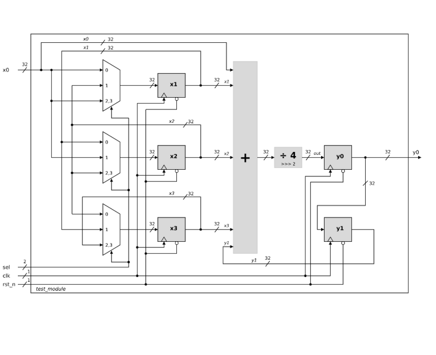

# 04 · RTL to block diagram

Block diagram derived from the Verilog description of a given module, `test_module` (32-bit datapath).

The module has three registers (`x1`, `x2`, `x3`) whose inputs are selected by a 2-bit `sel` through 3:1 multiplexers, a five-input adder (`x0 + x1 + x2 + x3 + y1`), a divide-by-4 implemented as an arithmetic right shift (`>>> 2`), and two output registers (`y0`, and `y1` holding the previous `y0`). All registers share `clk` and the active-low reset `rst_n`.
