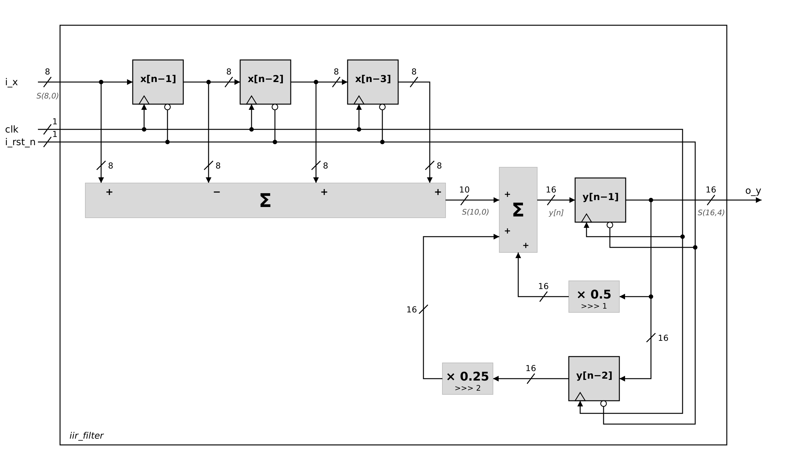

# 05 · Fixed-point IIR filter (direct form I)

```
y[n] = x[n] - x[n-1] + x[n-2] + x[n-3] + 0.5·y[n-1] + 0.25·y[n-2]
```



## Design

| Signal | Format | Range |
|--------|--------|-------|
| `i_x` | S(8,0) | [-128, 127] |
| FIR sum | S(10,0) | [-511, 509] (4 terms → +2 bits) |
| `o_y` | S(16,4) | 12 integer + 4 fractional bits |

- **Multiplier-free:** the 0.5 and 0.25 coefficients are arithmetic right shifts (`>>> 1`, `>>> 2`).
- **Bit growth:** the FIR sum is aligned to S(16,4) by appending 4 fractional zeros; sign extension comes from signed arithmetic.
- **Output width from worst-case analysis:** the L1 norm of the impulse response is 9, so the output peaks at about +1143 / -1152, which needs 12 integer bits (11 bits only reach ±1024).
- **Registered output:** `o_y` shows y[n] one clock cycle after x[n]. Reset is asynchronous and active low.
- **DC gain:** 8, so a constant 127 input settles at 1015.6875 (ideal 1016).

## Verification

`tb/tb_iir_filter_autocheck.v` is a self-checking testbench (`make iir_check`). Every output sample is compared against two reference models running in the testbench:

1. **Bit-exact integer model** with the same S(16,4) format and shifts: the output must match bit for bit.
2. **Ideal real-number model:** the quantization error must stay within the theoretical bound of 5 LSB = 0.3125.

Stimulus: impulse response, positive and negative steps, worst-case sequences that maximize |y|, an asynchronous reset between clock edges, and 40,000 random samples (uniform and extreme values).

```
Samples checked      : 40372
Errors               : 0
Max error vs ideal   : 0.3125  (theoretical bound 0.3125)
o_y range            : [-1151.5000, 1143.1875]
```

`tb/tb_iir_filter.v` is the directed testbench used for waveform inspection, with the expected value of each step in the comments (`make iir`).
